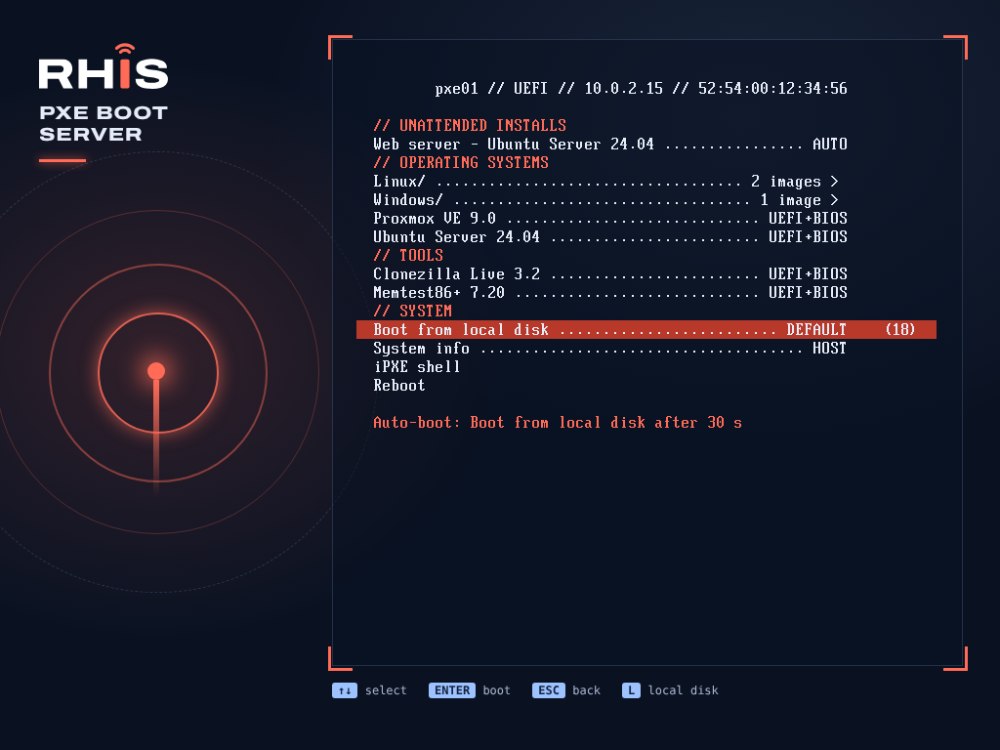

<p align="center"></p>

# PXE Boot Server

*English: [README.md](README.md)*

Een netwerkbootserver voor Debian 13 die werkt als Ventoy via het netwerk. Upload ISO-bestanden in de webinterface, zet ze in mappen en start ze op elke machine in je netwerk, met **UEFI en Legacy BIOS**.

- **Windows**-installaties (10, 11, Server) via wimboot. Setup leest de ISO via een ingebouwde, alleen-lezen Windows-share.
- **Linux**: Ubuntu, Debian (installer en live), Rocky/Alma/RHEL/Fedora, Arch en **Proxmox VE/PBS/PMG**, gestart met de juiste kernelopties via HTTP.
- **Elke andere ISO** (tools, firmware-updates, rescue-schijven) via iPXE `sanboot`, of `memdisk` voor Legacy BIOS.



## Functies

| | |
|---|---|
| ISO-bibliotheek | Hervatbare uploads van grote ISO's (in delen, overleven een verbroken verbinding), mappen worden submenu's, de bootmethode wordt automatisch herkend. |
| ISO-catalogus | Met één klik Ubuntu, Debian, Rocky, Proxmox VE/PBS, TrueNAS, Clonezilla en Memtest86+ downloaden, altijd de nieuwste versie, gecontroleerd met de checksum van de leverancier. Of een willekeurige ISO via een URL. Downloads gaan verder na een herstart. |
| Bootmenu | Gemaakt uit de bibliotheek, in RHIS-stijl: een grafisch schermvullend menu op UEFI (tekst in RHIS-kleuren op legacy BIOS), met secties voor onbeheerde installaties, besturingssystemen, tools en systeeminfo. Machines met een regel krijgen een kort auto-bootscherm met 5 seconden aftellen. Standaardkeuze, wachttijd, titel en een live voorbeeld in de webinterface. |
| Live clients | Welke client wat aan het booten is, firmwaretype, voortgang en snelheid. |
| Statistieken | Bandbreedte in de tijd, verstuurde data per dag, lopende taken, populairste ISO's. |
| Antwoordbestanden | Wizard in zes stappen voor installaties zonder vragen: Windows `autounattend.xml` (editie, productcode, lokale beheerder, schijf, Win11-controles), Ubuntu autoinstall, Debian preseed, Kickstart en Proxmox `answer.toml`. |
| Machines & groepen | Koppel een MAC-adres of een groep machines aan een ISO (en eventueel een antwoordbestand): alleen de volgende boot, elke boot, of voorgeselecteerd in het menu. Groepen vangen nieuwe machines op MAC-prefix, bijvoorbeeld alle Proxmox-VM's. |
| Serverlogs | Live HTTP-verzoeken (nginx), TFTP-overdrachten en DHCP/PXE-antwoorden (dnsmasq), te filteren op IP, MAC of bestand. |
| Proxmox-VM's | Maak een VM op Proxmox VE (API-token) die een gekozen ISO via het netwerk opstart, eventueel met antwoordbestand: juiste bootvolgorde, 2 MB OVMF-vars voor UEFI-PXE, VirtIO voor Linux en SATA/E1000/TPM voor Windows. |
| Netwerk & PXE | Proxy DHCP naast je bestaande router (standaard) of een volledige DHCP-server; netwerkkaarten kiezen; VLAN-interfaces toevoegen. |
| Secure Boot | Optioneel: UEFI-clients krijgen de door Microsoft ondertekende shim en de officiële ondertekende iPXE (gedownload door de installer/updater), en Linux-installers starten via hun eigen ondertekende shim. Windows start via de ondertekende wimboot. |
| VLAN-handleidingen | Stap voor stap voor UniFi UDM-Pro, in de app en in [docs/](docs/howto-vlan-unifi.nl.md). |
| Mailserver | Je eigen SMTP-server met STARTTLS of SSL/TLS, inloggegevens en een testknop; voor wachtwoordherstel en meldingen. |
| Info & updates | Versie, controleren op updates en updaten vanuit de webinterface; wisselen tussen het kanaal `main` (productie) en `test`. |
| Talen | Engels en Nederlands, per gebruiker te kiezen. Licht en donker thema. |

## Installeren

Op een verse **Debian 13 (trixie)**-server of VM, als root:

```bash
curl -fsSL https://raw.githubusercontent.com/rhisijmuiden/pxe-boot-server/main/install.sh | bash
```

Opties geef je mee na `bash -s --`:

```bash
# het test-kanaal installeren en eth1 gebruiken voor PXE
curl -fsSL https://raw.githubusercontent.com/rhisijmuiden/pxe-boot-server/main/install.sh | bash -s -- --channel test --interface eth1
```

Open daarna `http://<server-ip>/` en maak het eerste beheerdersaccount aan.

**Vereisten**: Debian 13, amd64, een vast IP-adres (of een DHCP-reservering) en genoeg schijfruimte onder `/srv/pxe` voor je ISO's. Op de clients moet **Secure Boot uit** staan (iPXE en wimboot zijn niet door Microsoft ondertekend).

**Virtuele machines in Proxmox VE**: in onze tests werkte UEFI-netwerkboot alleen als de EFI-schijf van de VM het **2MB OVMF**-formaat gebruikt. Met het 4MB-formaat startte de VM niet via het netwerk. VM's met Legacy BIOS (SeaBIOS) werken zoals ze zijn.

### Wat de installer doet

- Installeert `nginx`, `dnsmasq`, `samba`, `xorriso`, `syslinux-common`, Python 3 en git.
- Kloont deze repository naar `/opt/pxe-boot-server` en maakt een Python-omgeving aan.
- Maakt de gebruikers `pxeboot` (draait de webapp) en `pxe` (alleen-lezen Windows-share).
- Zet de iPXE-bootbestanden in `/srv/pxe/tftp`, downloadt `wimboot` en stelt nginx, Samba, dnsmasq (proxy DHCP op de netwerkkaart met de standaardroute) en systemd in.

Je kunt de installer veilig opnieuw draaien; hij werkt dan de code en de configuratie bij.

## Zo werkt het

```
firmware client ──PXE/DHCP──▶ dnsmasq (proxy DHCP) ──TFTP──▶ iPXE (undionly.kpxe / snponly.efi)
iPXE ──HTTP──▶ /ipxe/boot.ipxe ─▶ menu ─▶ gekozen ISO
  Windows : wimboot + boot.wim, Setup leest \\server\pxe via SMB
  Linux   : kernel + initrd uit de gekoppelde ISO via HTTP
  overig  : sanboot (ISO als virtuele cd via HTTP) of memdisk
```

| Pad | Inhoud |
|---|---|
| `/opt/pxe-boot-server` | Code (deze repository) |
| `/srv/pxe/isos` | Geüploade ISO's en mappen |
| `/srv/pxe/mnt/<id>` | Alleen-lezen koppelingen van de ISO's |
| `/srv/pxe/tftp` | iPXE-bootbestanden |
| `/var/lib/pxe-boot-server` | Database en instellingen |
| `/var/log/pxe-boot-server` | Updatelog |

### Poorten

| Protocol | Poort | Waarvoor |
|---|---|---|
| UDP | 67, 4011 | DHCP / proxy DHCP |
| UDP | 69, 30000-30100 | TFTP |
| TCP | 80 | Webinterface, menu, kernels, ISO's |
| TCP | 445 | Windows-share voor Setup |

## Meerdere VLAN's

PXE begint met een broadcast die binnen het VLAN blijft. In **[De PXE-server over meerdere VLAN's gebruiken met een UniFi UDM-Pro](docs/howto-vlan-unifi.nl.md)** staan drie manieren om dat op te lossen. Dezelfde handleiding staat in de app onder *Help & how-to's*.

## Updates en kanalen

`main` is het productiekanaal en `test` krijgt wijzigingen eerst. Open in de webinterface **Info & updates** linksonder, kies het kanaal, controleer op updates en klik op **Nu updaten**. De update draait `deploy/post-update.sh` en herstart de app. Vanaf de shell:

```bash
sudo /opt/pxe-boot-server/bin/pxe-helper update main   # of: test
tail -f /var/log/pxe-boot-server/update.log
```

## Ontwikkelen

Zie de [Engelse README](README.md#development).
